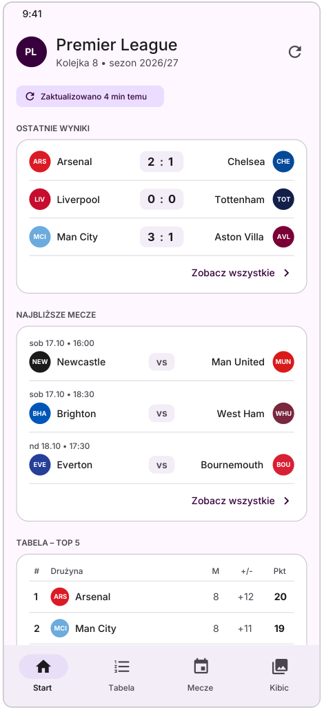
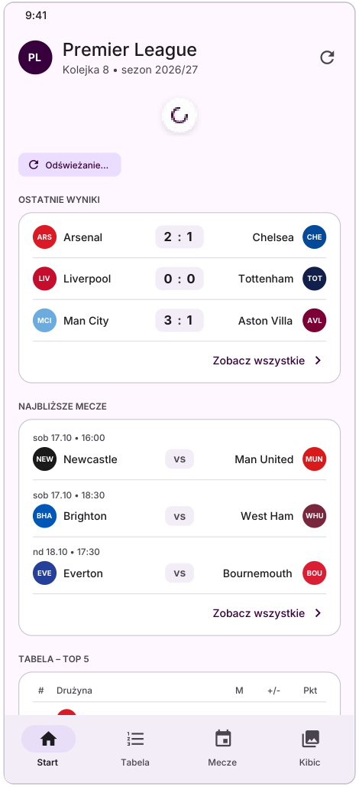
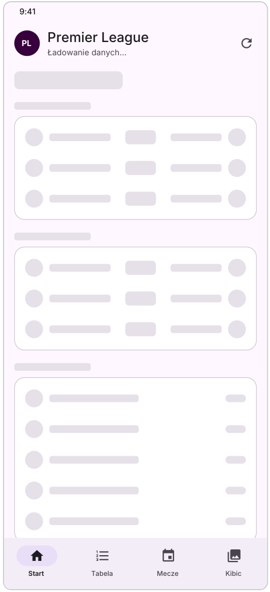
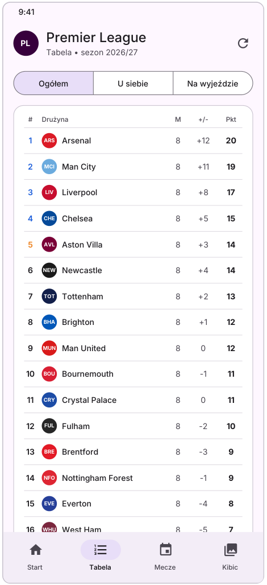
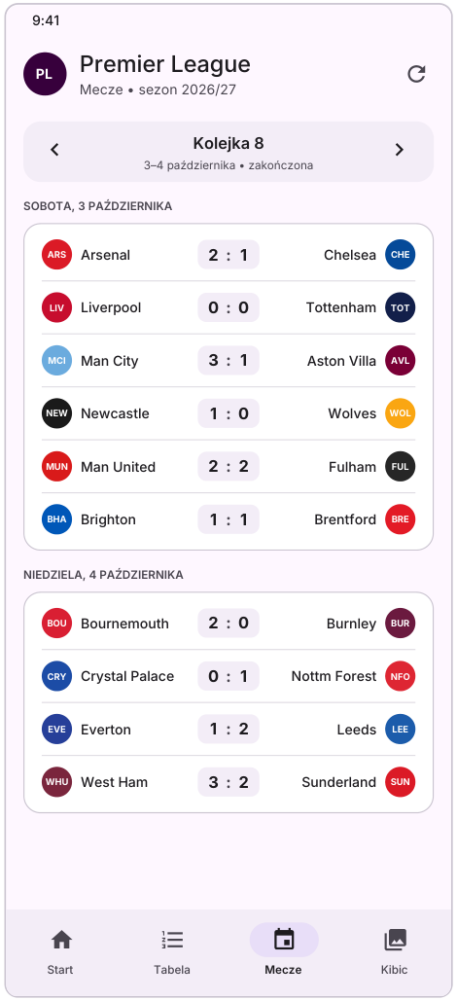
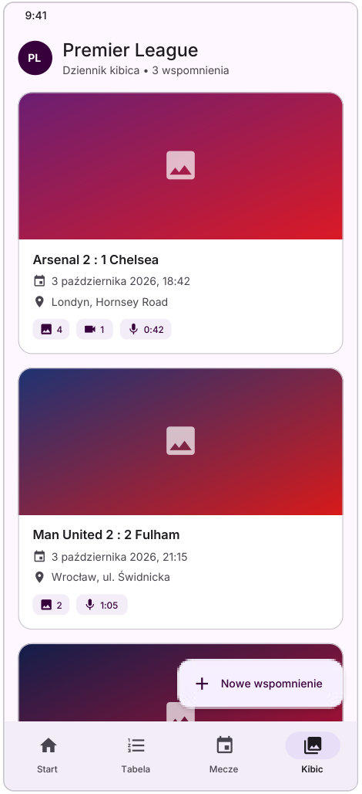
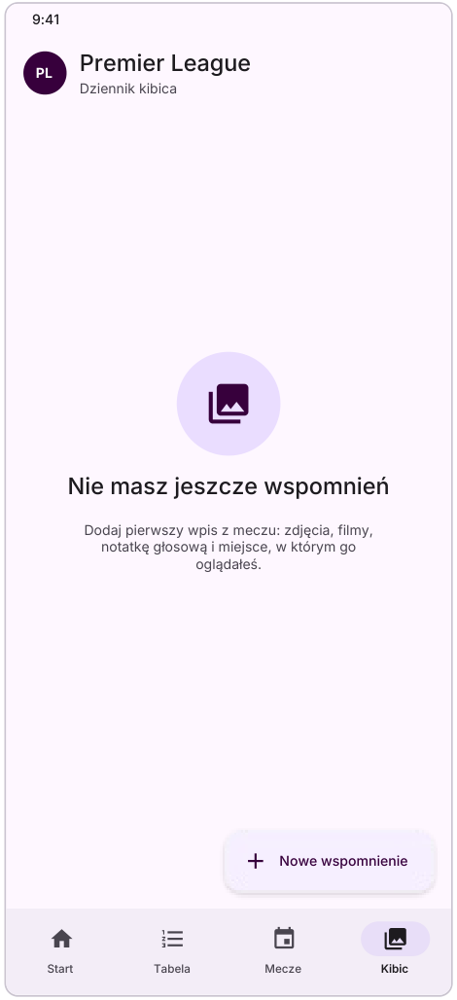
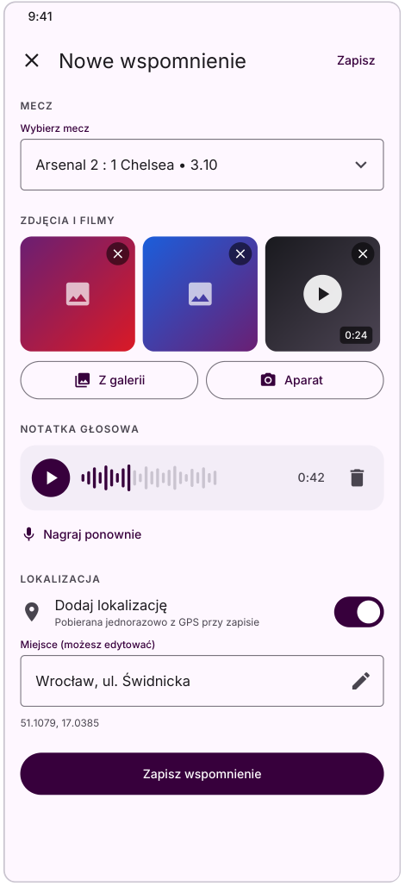
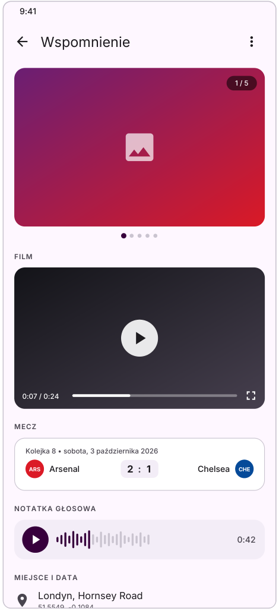

# Premier League App

Natywna aplikacja na Androida (Kotlin, Jetpack Compose) dla kibiców angielskiej Premier League. Łączy aktualne informacje o lidze (wyniki, terminarz, tabela) z osobistym **Dziennikiem kibica**, w którym użytkownik zapisuje wspomnienia z obejrzanych meczów – ze zdjęciami, filmami, notatką głosową i lokalizacją.

> **Status:** Etap 0 – projekt i dokumentacja. Implementacja jest planowana w pionowych wycinkach (vertical slices).
>
> 📄 **Pełna dokumentacja projektu:** [Premier_League_App_opis_projektu.pdf](Premier_League_App_opis_projektu.pdf) – opis funkcji, wszystkie ekrany i ich stany, plan implementacji, podejście offline-first, strategia mocków, technologie oraz diagramy architektury MVVM.

## Funkcje

**Część ligowa** (dane z [football-data.org](https://www.football-data.org/) API v4, darmowy plan)
- ekran **Start** – bieżąca kolejka, ostatnie wyniki, najbliższe mecze i top 5 tabeli,
- **Tabela** – pełna klasyfikacja 20 drużyn (ogółem / u siebie / na wyjeździe) ze strefami: Liga Mistrzów, Liga Europy, spadek,
- **Mecze** – terminarz i wyniki wybranej kolejki, pogrupowane po dniach,
- informacja o wieku danych i odświeżanie gestem pull-to-refresh.

**Dziennik kibica** (dane użytkownika, przechowywane lokalnie)
- wspomnienia przypisane do meczów,
- zdjęcia i filmy z galerii (Photo Picker) lub z aparatu,
- nagrywanie i odsłuchiwanie notatki głosowej,
- jednorazowa lokalizacja GPS zamieniana na adres (do ręcznej poprawy),
- edycja i usuwanie wpisów.

Aplikacja działa także **bez internetu** – ekrany czytają dane z lokalnej bazy, a API służy tylko do jej odświeżania (dane starsze niż 15 minut lub wymuszone odświeżenie).

## Przykładowe ekrany

Makiety zostały przygotowane w Figmie w oparciu o Material 3 ([projekt w Figmie](https://www.figma.com/design/s4WVPKt0PGlq5KRlpJAxv0/Premier-League-App-%E2%80%93-makiety?node-id=0-1&p=f&t=DWqoy9a8Qez6UURu-0)). Dane na makietach są przykładowe.

### Część ligowa

**Start** (dane z cache, odświeżanie, pierwsze ładowanie)

  

**Tabela** i **Mecze**

 

### Dziennik kibica

**Lista wspomnień**, **brak wspomnień**, **nowe wspomnienie**, **szczegóły wspomnienia**

   

Pozostałe stany ekranu Start (błąd z danymi z cache, błąd bez danych) opisano w pełnej dokumentacji.

## Technologie

| Obszar | Technologia |
|---|---|
| Język i UI | Kotlin, Jetpack Compose, Material 3 |
| Nawigacja | Navigation Compose |
| Architektura | MVVM, ViewModel, StateFlow, Coroutines |
| Wstrzykiwanie zależności | Hilt |
| Sieć | Retrofit, OkHttp, kotlinx.serialization |
| Baza danych | Room (SQLite) |
| Obrazy | Coil |
| Multimedia | Media3 (ExoPlayer), MediaRecorder, Photo Picker |
| Lokalizacja | Fused Location Provider, Geocoder |
| Testy | JUnit, MockK, Turbine |

## Architektura

Aplikacja używa architektury **MVVM** z trzema warstwami: View (ekrany Compose) → ViewModel (`UiState` w `StateFlow`) → Model (interfejsy repozytoriów w domenie i ich implementacje w warstwie danych). ViewModel zna wyłącznie interfejsy repozytoriów.

Każde repozytorium ligowe ma dwie implementacje wybierane przez product flavors:
- `mock` – `Fake...Repository` z danymi z makiet (z symulacją opóźnień i błędów),
- `prod` – `Default...Repository`, offline-first: Room + football-data.org.

Diagramy architektury znajdują się w pełnej dokumentacji (rozdział 8).

## Konfiguracja klucza API

Każde zapytanie do football-data.org wymaga klucza w nagłówku `X-Auth-Token`. Klucz nie jest przechowywany w repozytorium – należy dodać go do pliku `local.properties` (trafia do `BuildConfig`). Darmowy plan ma limit 10 zapytań na minutę i opóźnione wyniki.

## Plan implementacji

0. Projekt i dokumentacja
1. Fundament aplikacji (Scaffold, nawigacja, Hilt, motyw)
2. Model domenowy i mocki
3. Wycinki na mockach: Tabela → Mecze → Start
4. Baza Room i Dziennik kibica (lista i zdjęcia, następnie wideo, audio, GPS)
5. Podłączenie API i cache offline-first
6. Testy i oddanie

Szczegóły każdego etapu – w [pełnej dokumentacji](Premier_League_App_opis_projektu.pdf).

## Autor

Jakub Karolewski
