# Premier League App – opis projektu, architektury i etapów implementacji

Dokument opracowany na podstawie [README.md](../README.md), pełnej dokumentacji [Premier_League_App_opis_projektu.pdf](../Premier_League_App_opis_projektu.pdf) (16 stron, październik 2026) oraz aktualnego stanu kodu w repozytorium.

Fragmenty oznaczone jako **„Propozycja”** nie pochodzą z dokumentacji – to moje uzupełnienia tam, gdzie dokumentacja nie rozstrzyga szczegółu.

## Spis treści

1. [Czym jest projekt](#1-czym-jest-projekt)
2. [Funkcje aplikacji](#2-funkcje-aplikacji)
3. [Ekrany i ich stany](#3-ekrany-i-ich-stany)
4. [Architektura](#4-architektura)
5. [Dane offline – cache-first](#5-dane-offline--cache-first)
6. [Mocki i warianty budowania](#6-mocki-i-warianty-budowania)
7. [Technologie](#7-technologie)
8. [Stan repozytorium dzisiaj](#8-stan-repozytorium-dzisiaj)
9. [Etapy implementacji – opis szczegółowy](#9-etapy-implementacji--opis-szczegółowy)
10. [Decyzje projektowe](#10-decyzje-projektowe)

---

## 1. Czym jest projekt

Premier League App to natywna aplikacja na Androida (Kotlin, Jetpack Compose) dla kibiców angielskiej Premier League. Składa się z dwóch części:

- **Część ligowa** – wyniki, terminarz i tabela pobierane z API [football-data.org](https://www.football-data.org/) (v4, darmowy plan).
- **Dziennik kibica** – wspomnienia z obejrzanych meczów tworzone przez użytkownika i przechowywane wyłącznie na telefonie: zdjęcia, filmy, notatka głosowa i lokalizacja.

### Cel

Zbudowanie kompletnej aplikacji pokazującej dobre praktyki Androida: architekturę MVVM, pracę z zewnętrznym REST API, lokalną bazę danych, działanie bez internetu oraz korzystanie z funkcji urządzenia (aparat, mikrofon, galeria, lokalizacja).

### Wymagania projektu i ich realizacja

| Wymaganie | Realizacja w aplikacji |
|---|---|
| Komunikacja z zewnętrznym API | Tabela, mecze i informacje o lidze z football-data.org (Retrofit) |
| Geolokacja | Jednorazowe pobranie pozycji GPS przy wspomnieniu i zamiana na adres (Geocoder) |
| Plik audio | Nagrywanie i odtwarzanie notatki głosowej |
| Filmik | Odtwarzanie filmów dodanych do wspomnienia (Media3) |
| Wgrywanie własnych zdjęć i filmów | Multimedia z galerii (Photo Picker) lub z aparatu |

Wymagania multimedialne celowo połączono w jedną funkcję – Dziennik kibica. Każde wspomnienie jest pamiątką z konkretnego meczu, więc zdjęcia, film, komentarz głosowy i miejsce mają naturalne uzasadnienie, a całość da się pokazać jednym scenariuszem.

### Ograniczenia źródła danych

Darmowy plan football-data.org ma dwa ograniczenia, które kształtują cały projekt:

- wyniki są opóźnione (brak wyników na żywo),
- limit **10 zapytań na minutę**.

Dlatego aplikacja nie odpytuje API przy każdym wejściu na ekran – trzyma dane w lokalnej bazie i odświeża je według reguły 15 minut (rozdział 5). Każde zapytanie wymaga klucza w nagłówku `X-Auth-Token`. Klucz nie trafia do repozytorium: jest w `local.properties` i stamtąd przechodzi do `BuildConfig`.

---

## 2. Funkcje aplikacji

Aplikacja ma cztery zakładki w dolnym pasku nawigacji: **Start**, **Tabela**, **Mecze**, **Kibic**.

| Co może zrobić użytkownik | Ekran | Uwagi |
|---|---|---|
| Zobaczyć ostatnie wyniki, najbliższe mecze i czołówkę tabeli | Start | Ekran-podsumowanie z linkami do pełnych widoków |
| Sprawdzić wiek danych | Start, Tabela, Mecze | „Zaktualizowano X min temu” |
| Odświeżyć dane gestem lub przyciskiem | Start, Tabela, Mecze | Pull-to-refresh wymusza pobranie z API |
| Przeglądać pełną tabelę 20 drużyn | Tabela | Strefy: Liga Mistrzów, Liga Europy, spadek |
| Przełączać tabelę: ogółem / u siebie / na wyjeździe | Tabela | API zwraca wszystkie trzy warianty naraz |
| Przeglądać mecze wybranej kolejki, pogrupowane po dniach | Mecze | Zmiana kolejki strzałkami |
| Korzystać z aplikacji bez internetu | Wszystkie | Dane z lokalnej bazy |
| Przeglądać listę wspomnień | Kibic – lista | Pusty stan z zachętą przy pierwszym użyciu |
| Dodać wspomnienie do meczu | Kibic – nowe wspomnienie | Mecz wybierany z listy meczów ligi |
| Dodać zdjęcia i filmy z galerii lub aparatu | Kibic – nowe wspomnienie | Photo Picker nie wymaga uprawnień |
| Nagrać i odsłuchać notatkę głosową | Kibic – nowe wspomnienie, szczegóły | Uprawnienie do mikrofonu przy pierwszym nagraniu |
| Zapisać miejsce (GPS) i poprawić adres ręcznie | Kibic – nowe wspomnienie | Lokalizacja opcjonalna, pobierana jednorazowo |
| Obejrzeć wspomnienie, edytować je lub usunąć | Kibic – szczegóły | Edycja i usuwanie z menu |

---

## 3. Ekrany i ich stany

Makiety powstały w Figmie w oparciu o Material 3 ([projekt w Figmie](https://www.figma.com/design/s4WVPKt0PGlq5KRlpJAxv0/Premier-League-App-%E2%80%93-makiety?node-id=0-1&p=f&t=DWqoy9a8Qez6UURu-0)). Każdy ekran ma szkielet `Scaffold` z górnym paskiem i dolną nawigacją; przewija się tylko zawartość między nimi. Zrzuty makiet są w [docs/screenshots](screenshots/).

### 3.1 Start – podsumowanie ligi

Zawiera: numer bieżącej kolejki i sezon, trzy ostatnie wyniki, trzy najbliższe mecze, pięć pierwszych drużyn tabeli. Linki „Zobacz wszystkie” i „Pełna tabela” prowadzą do zakładek Mecze i Tabela. Chip pod nagłówkiem pokazuje wiek danych, a przycisk w prawym górnym rogu (lub przeciągnięcie w dół) odświeża dane.

Ekran zaprojektowano we wszystkich pięciu stanach, które odpowiadają stanom `UiState` i działaniu cache:

| Stan | Kiedy występuje | Co widać |
|---|---|---|
| Pierwsze ładowanie | Pierwsze uruchomienie, baza pusta, trwa pobieranie | Szkielety (skeleton), „Ładowanie danych…” |
| Dane z cache | Stan normalny | Dane z bazy i ich wiek |
| Odświeżanie | Trwa pobieranie nowych danych | Stare dane cały czas widoczne + „Odświeżanie…” |
| Błąd, dane z cache | Odświeżenie nieudane (brak sieci, limit API), ale baza ma dane | Stare dane + snackbar „Ponów” |
| Błąd, brak danych | Odświeżenie nieudane i baza pusta | „Brak połączenia” + przycisk „Spróbuj ponownie” |

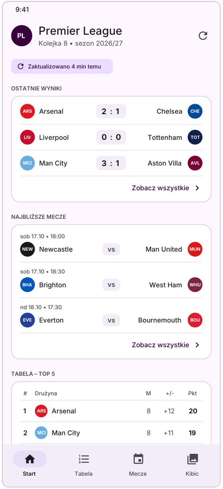 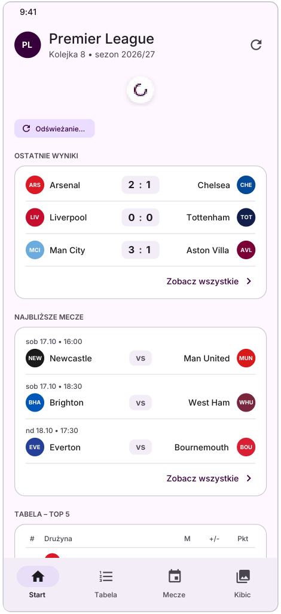 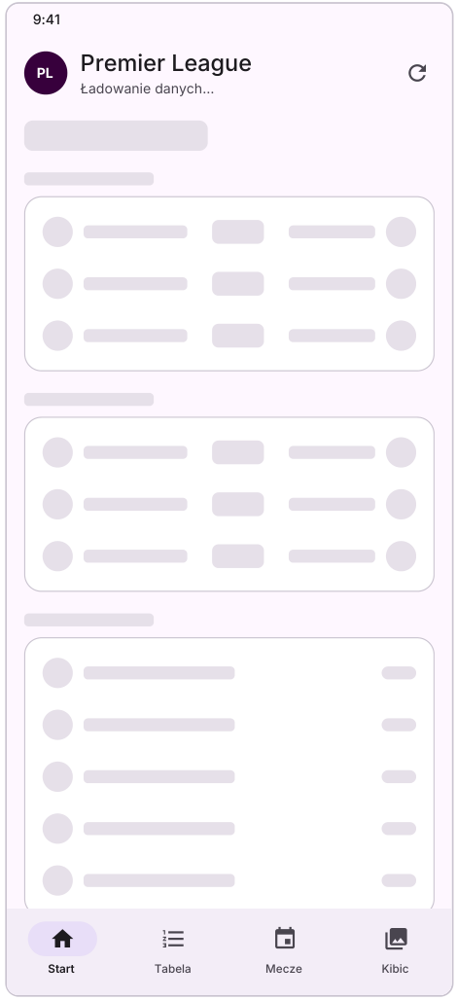

### 3.2 Tabela

Pełna klasyfikacja 20 drużyn: pozycja, herb, nazwa, liczba meczów (M), bilans bramek (+/-), punkty (Pkt). Przełącznik u góry (`SegmentedButton`) zmienia widok: **Ogółem / U siebie / Na wyjeździe**. Kolor numeru pozycji oznacza strefę:

- miejsca 1–4 – Liga Mistrzów,
- miejsce 5 – Liga Europy,
- miejsca 18–20 – spadek.

### 3.3 Mecze

Terminarz i wyniki wybranej kolejki. Strzałki w nagłówku zmieniają kolejkę, pod nagłówkiem jest zakres dat i status kolejki (np. „3–4 października • zakończona”). Mecze są pogrupowane według dni. **Ten sam komponent wiersza meczu** jest używany na ekranie Start i w szczegółach wspomnienia.

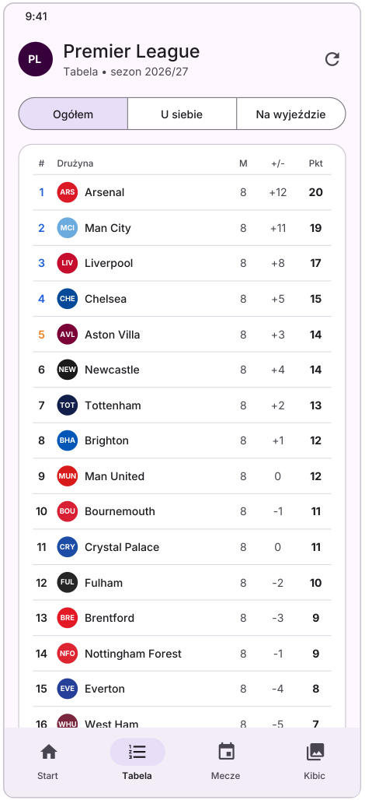 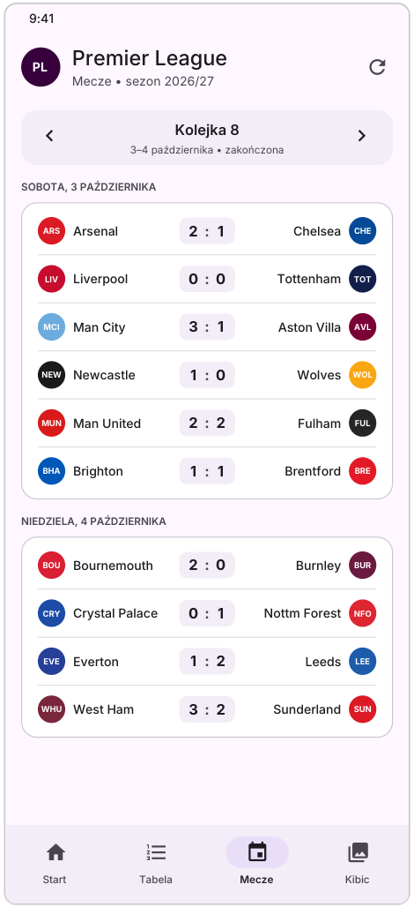

### 3.4 Kibic – dziennik wspomnień

**Lista wspomnień.** Karta wpisu pokazuje miniaturę pierwszego zdjęcia, mecz z wynikiem, datę dodania, miejsce oraz liczniki zdjęć, filmów i długość notatki głosowej. Elementy, których wpis nie ma (lokalizacja, notatka), po prostu się nie wyświetlają. Przy braku wpisów widać pusty stan z zachętą. Przycisk „Nowe wspomnienie” otwiera formularz.

**Nowe wspomnienie (formularz).** Sekcje po kolei:

1. **Mecz** – wybór z listy meczów ligi.
2. **Zdjęcia i filmy** – przyciski „Z galerii” i „Aparat”.
3. **Notatka głosowa** – nagrywanie, odsłuch, „Nagraj ponownie”.
4. **Lokalizacja** – przełącznik „Dodaj lokalizację”; po włączeniu aplikacja jednorazowo pobiera pozycję GPS i zamienia ją na adres, który można poprawić ręcznie. Współrzędne i adres są zapisywane na stałe jako pamiątka.

**Szczegóły wspomnienia.** Przewijana galeria zdjęć (ze wskaźnikiem np. 1/5), odtwarzacz filmu, karta meczu, odtwarzacz notatki głosowej, miejsce i data dodania. Menu w prawym górnym rogu: edycja i usuwanie.

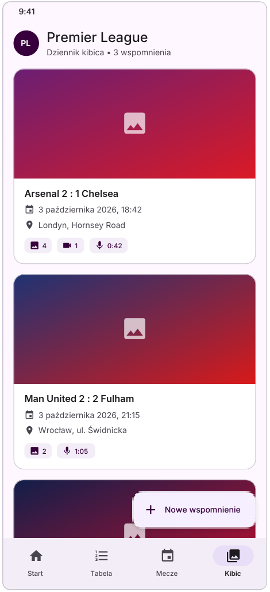 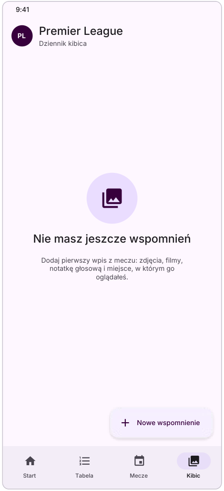 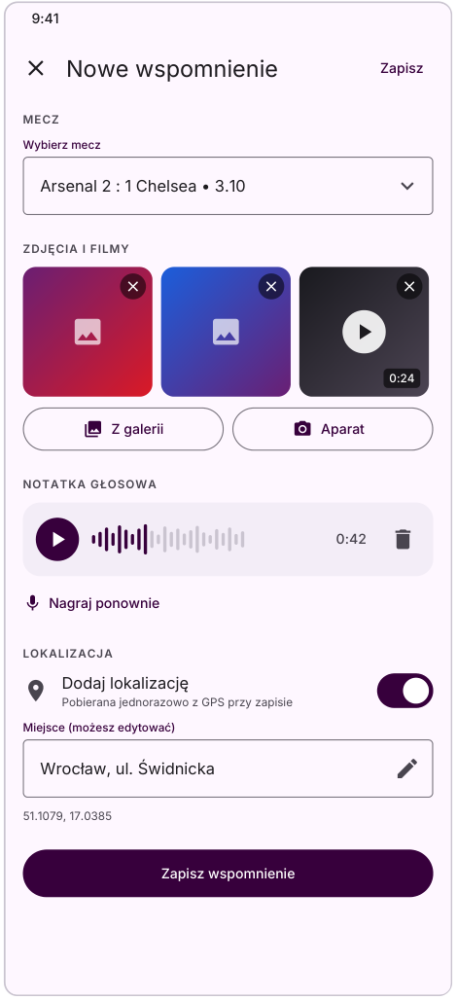 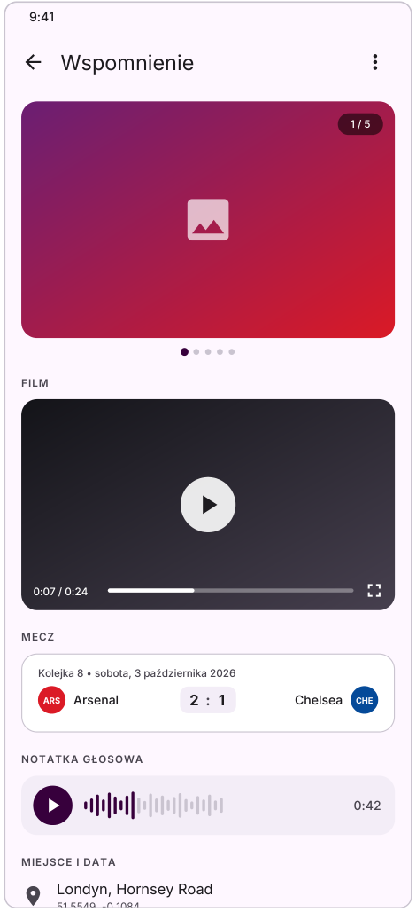

### 3.5 Uprawnienia i obsługa odmowy

| Funkcja urządzenia | Uprawnienie i zachowanie po odmowie |
|---|---|
| Galeria (Photo Picker) | Nie wymaga uprawnień |
| Aparat | Systemowa aplikacja aparatu – w praktyce bez dodatkowych uprawnień |
| Mikrofon | `RECORD_AUDIO`, pytanie przy pierwszym nagraniu; po odmowie nagrywanie jest niedostępne, reszta formularza działa |
| Lokalizacja | `ACCESS_COARSE_LOCATION`, pytanie po włączeniu przełącznika; po odmowie przełącznik się wyłącza, miejsce można wpisać ręcznie |

---

## 4. Architektura

### 4.1 Warstwy MVVM

| Warstwa | Odpowiedzialność | W projekcie |
|---|---|---|
| **View** | Wyświetla stan i przekazuje akcje użytkownika. Nie zawiera logiki. | Ekrany Compose: `StartScreen`, `StandingsScreen`, `MatchesScreen`, ekrany dziennika (`MemoriesList`, `MemoryEditor`, `MemoryDetails`), wspólny szkielet aplikacji (Scaffold, NavigationBar, NavHost, motyw) |
| **ViewModel** | Trzyma stan ekranu (`UiState`), reaguje na akcje, woła Model. Przeżywa obrót ekranu. | `StartViewModel`, `StandingsViewModel`, `MatchesViewModel`, `MemoriesViewModel`, `MemoryEditorViewModel` (wszystkie `@HiltViewModel`) |
| **Model – domena** | Modele i interfejsy repozytoriów. Czysty Kotlin, bez zależności od Androida. | `Team`, `Match`, `StandingRow`, `StandingType`, `Competition`, `Memory`, `MemoryMedia`; `CompetitionRepository`, `StandingsRepository`, `MatchesRepository`, `MemoriesRepository` |
| **Model – dane** | Implementacje repozytoriów i źródła danych. | `Fake…Repository` (mock), `Default…Repository` (prod), `MemoriesRepositoryImpl`, `FootballApi` + `AuthInterceptor`, `AppDatabase` z DAO, `MediaStorage`, `AudioRecorder`, `LocationProvider` |

### 4.2 Dwie główne zasady

1. **Zależności idą w dół.** View zna ViewModel, ViewModel zna tylko *interfejs* repozytorium. ViewModel nie wie, czy dane pochodzą z mocka, API czy bazy.
2. **Stan płynie w górę, zdarzenia w dół.** Kliknięcia i gesty to wywołania funkcji ViewModelu. Dane wracają strumieniami: Room i repozytoria zwracają `Flow`, ViewModel wystawia `StateFlow<UiState>`, a ekran obserwuje go przez `collectAsStateWithLifecycle()` i sam się przerysowuje.

### 4.3 Przegląd całej aplikacji (odpowiednik Diagramu A)

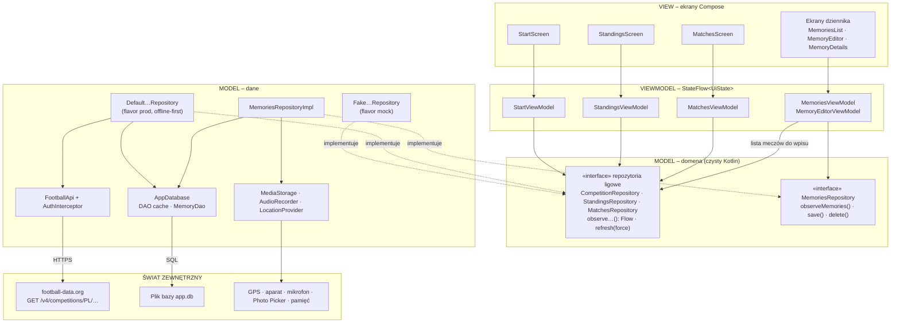

`StartViewModel` łączy dane z trzech repozytoriów ligowych. Dziennik kibica korzysta z repozytorium meczów (lista meczów do wyboru we wpisie), ale nie wymaga API – jego dane żyją w Room i w plikach urządzenia. **Hilt** spina wszystkie warstwy i zależnie od wariantu budowania wstrzykuje `Fake…` albo `Default…`.

### 4.4 Stan ekranu – `UiState`

Każdy ekran ma własny `sealed interface` o trzech stanach:

- `Loading` – pierwsze ładowanie, brak danych,
- `Content(dane, isRefreshing)` – dane z cache, także w trakcie odświeżania,
- `Error(message)` – **wyłącznie** gdy odświeżenie się nie udało, a danych nie ma (pełny ekran błędu z „Spróbuj ponownie”).

Nieudane odświeżenie przy istniejących danych **nie zmienia stanu** – ekran zostaje w `Content`, a ViewModel wysyła jednorazowe zdarzenie, które ekran pokazuje jako snackbar „Ponów” (decyzja 3 w rozdziale 10). Dla Tabeli:

```kotlin
sealed interface StandingsUiState {
    data object Loading : StandingsUiState
    data class Content(
        val rows: List<StandingRow>,
        val type: StandingType,
        val isRefreshing: Boolean,
        val lastUpdated: /* czas aktualizacji */
    ) : StandingsUiState
    data class Error(val message: String) : StandingsUiState
}

sealed interface StandingsEvent {
    data class RefreshFailed(val message: String) : StandingsEvent
}
```

`StandingsViewModel` wystawia `uiState: StateFlow<StandingsUiState>`, strumień zdarzeń `events: Flow<StandingsEvent>` oraz akcje `onRefresh()` i `onTypeSelected(type)`.

To świadome odstępstwo od Diagramu B w PDF, gdzie `Error` ma jeszcze pole `cachedRows`.

### 4.5 Wycinek „Tabela” – przepływ pull-to-refresh (odpowiednik Diagramu B)

Ten sam wzorzec powtarzają Mecze, Start i Dziennik kibica.

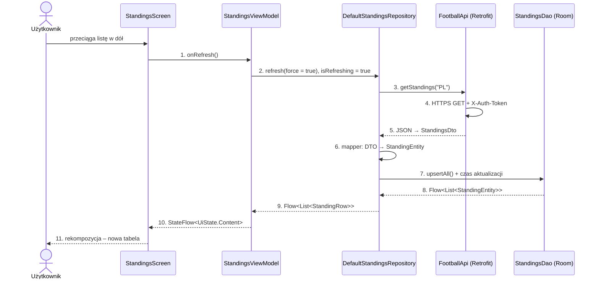

- **Mapowanie:** `StandingsDto → StandingEntity → StandingRow` (pola modelu domenowego: `position`, `team`, `played`, `goalDifference`, `points`).
- **DAO:** `observe(type): Flow<List<StandingEntity>>`, `upsertAll(rows)`, `lastUpdated()`.
- **Błąd sieci (kroki 4–5):** repozytorium zgłasza wyjątek; gdy dane są w cache, stan zostaje `Content`, a ViewModel wysyła zdarzenie `RefreshFailed` (snackbar); gdy cache jest pusty – stan `Error`.
- **Wariant mock:** kroki 3–8 zastępuje `FakeStandingsRepository` (dane z makiet w `MutableStateFlow`; `refresh()` to `delay` + opcjonalny błąd). Kroki 1, 2 i 9–11 są identyczne.

### 4.6 Struktura pakietów

**Propozycja** (dokumentacja nie narzuca układu pakietów; układ wynika z warstw i z podziału na flavors):

```
app/src/
├── main/java/com/example/premierleagueapp/
│   ├── ui/
│   │   ├── theme/            motyw z Figmy
│   │   ├── components/       wspólne: wiersz meczu, wiersz tabeli, chip wieku danych
│   │   ├── navigation/       NavHost, trasy, NavigationBar
│   │   ├── start/            StartScreen, StartViewModel, StartUiState
│   │   ├── standings/        StandingsScreen, StandingsViewModel, StandingsUiState
│   │   ├── matches/          MatchesScreen, MatchesViewModel, MatchesUiState
│   │   └── memories/         lista, edytor, szczegóły + ViewModele
│   ├── domain/
│   │   ├── model/            Team, Match, StandingRow, StandingType, Competition, Memory, MemoryMedia
│   │   └── repository/       interfejsy repozytoriów
│   └── data/
│       ├── local/            AppDatabase, encje, DAO
│       ├── memories/         MemoriesRepositoryImpl
│       └── device/           MediaStorage, AudioRecorder, LocationProvider
├── mock/java/…/              Fake…Repository + moduł Hilt wariantu mock
└── prod/java/…/              FootballApi, DTO, mappery, Default…Repository + moduł Hilt wariantu prod
```

---

## 5. Dane offline – cache-first

Ekran **nigdy** nie czyta danych bezpośrednio z API. Zawsze czyta z bazy Room, a API służy wyłącznie do jej aktualizowania. Baza jest jedynym źródłem prawdy dla interfejsu.

```
Ekran ──obserwuje──► Room (Flow) ◄──zapis── Repozytorium ──► API
                                                  ▲
                    pull-to-refresh lub dane starsze niż 15 minut
```

### Jak to działa krok po kroku

1. **Wejście na ekran** – dane z bazy pojawiają się natychmiast.
2. **Sprawdzenie świeżości** – repozytorium sprawdza zapisany w bazie czas ostatniej aktualizacji. Jeśli dane są starsze niż **15 minut**, w tle wysyła zapytanie do API.
3. **Odpowiedź z API** – nowe dane trafiają do bazy; Room sam powiadamia ekran przez `Flow`.
4. **Pull-to-refresh** – wymusza pobranie niezależnie od wieku danych (`refresh(force = true)`).
5. **Błąd sieci lub limitu API** – dane z bazy zostają na ekranie, pojawia się komunikat „Nie udało się odświeżyć” z opcją ponowienia. Pełnoekranowy błąd tylko wtedy, gdy baza jest pusta.

### Co to daje

- działanie w trybie samolotowym po pierwszym pobraniu, z informacją o wieku danych,
- zwykłe przełączanie zakładek nie zużywa limitu 10 zapytań/min,
- ekran nie czeka na sieć,
- UI ma zawsze jedno źródło danych, niezależnie od stanu sieci.

### Trwałość danych i migracje

Baza Room to plik SQLite (`app.db`) w prywatnym katalogu aplikacji. Dane przetrwają zamknięcie aplikacji, restart telefonu i aktualizację; znikają po odinstalowaniu lub wyczyszczeniu danych aplikacji.

**Jedna baza, dwa rodzaje danych.** W tej samej bazie są dane ligowe (cache – zawsze da się pobrać ponownie) i wspomnienia (dane użytkownika – nie wolno ich utracić). Dlatego zmiana schematu nie może kasować bazy (żadnego `fallbackToDestructiveMigration`). Tabele wspomnień powstają w etapie 6, a tabele cache są dodawane w etapie 9 przez `@AutoMigration`, która zachowuje istniejące wspomnienia. Warunkiem jest eksport schematu włączony już w etapie 6.

---

## 6. Mocki i warianty budowania

Przez większość projektu aplikacja działa na danych testowych. Każde repozytorium ligowe to interfejs z dwiema implementacjami:

| Implementacja | Wariant | Zachowanie |
|---|---|---|
| `Fake…Repository` | `mock` | Dane przygotowane na podstawie makiet, konfigurowalne opóźnienie i symulacja błędów |
| `Default…Repository` | `prod` | Offline-first: Room + football-data.org |

Wyboru dokonuje Gradle przez **product flavors** `mock` i `prod`, a Hilt wstrzykuje implementację należącą do wybranego wariantu. Warianty mają różny `applicationId` (mock z przyrostkiem `.mock`), więc mogą być zainstalowane obok siebie.

**Zabezpieczenie terminu.** Podłączenie API to jeden z ostatnich etapów (8). Jeśli zabraknie na niego czasu, aplikacja i tak jest kompletna na danych testowych – wszystkie ekrany, stany i Dziennik kibica działają niezależnie od API.

Dodatkowe korzyści:

- tworzenie UI nie zużywa limitu API i nie wymaga internetu,
- stany ładowania i błędu można wywołać celowo, bez wyłączania sieci,
- wariant `mock` daje przewidywalne dane na prezentacji – niezależnie od sieci na sali i od tego, czy trwa sezon,
- ViewModele testuje się na fake'ach, bez emulatora,
- w etapie 8 zmienia się tylko implementacja repozytoriów; ekrany i ViewModele zostają bez zmian.

---

## 7. Technologie

| Obszar | Technologia | Zastosowanie |
|---|---|---|
| Język i UI | Kotlin, Jetpack Compose, Material 3 | Ekrany i komponenty interfejsu |
| Nawigacja | Navigation Compose | Przejścia między zakładkami i ekranami |
| Architektura | ViewModel, StateFlow, Coroutines | Stan ekranów, operacje w tle |
| Wstrzykiwanie zależności | Hilt | Spinanie warstw, wybór mock / prod |
| Sieć | Retrofit, OkHttp, kotlinx.serialization | Zapytania do API i parsowanie JSON |
| Baza danych | Room (SQLite) | Cache danych ligowych i wspomnienia |
| Obrazy | Coil | Herby klubów, zdjęcia ze wspomnień |
| Multimedia | Media3 (ExoPlayer), MediaRecorder, Photo Picker | Film, notatka głosowa, wybór plików |
| Lokalizacja | Fused Location Provider, Geocoder | Pozycja i adres przy wspomnieniu |
| Testy | JUnit, MockK, Turbine | Testy repozytoriów i ViewModeli |

---

## 8. Stan repozytorium dzisiaj

Stan na 13 listopada 2026, gałąź `feature/E1`.

**Co już jest:**

- dokumentacja (README, PDF, zrzuty makiet w `docs/screenshots`),
- projekt wygenerowany z szablonu Android Studio „Empty Activity”: jeden moduł `:app`, pakiet `com.example.premierleagueapp`,
- [MainActivity.kt](../app/src/main/java/com/example/premierleagueapp/MainActivity.kt) z szablonowym `Greeting("Android")` w `Scaffold`,
- domyślny motyw szablonu w `ui/theme` (fioletowa paleta, włączone kolory dynamiczne) – jeszcze nie motyw z Figmy.

**Konfiguracja budowania:**

| Element | Wartość |
|---|---|
| Android Gradle Plugin | 9.4.1 |
| Gradle (wrapper) | 9.6.0 |
| Kotlin | 2.2.10 |
| Compose BOM | 2026.02.01 |
| `compileSdk` / `targetSdk` | 37 |
| `minSdk` | 26 |
| Java | 11 |
| Katalog wersji | [gradle/libs.versions.toml](../gradle/libs.versions.toml) |

**Czego jeszcze nie ma** (względem planu): Navigation Compose, Hilt, product flavors, Retrofit/OkHttp, kotlinx.serialization, Room, Coil, Media3, usługi lokalizacji, MockK, Turbine; brak warstw `domain` i `data`; manifest nie deklaruje żadnych uprawnień (`INTERNET`, `RECORD_AUDIO`, `ACCESS_COARSE_LOCATION`); `BuildConfig` nie jest włączony i klucz API nie jest jeszcze czytany z `local.properties`.

Wniosek: etap 0 jest zakończony, a projekt stoi na samym początku etapu 1.

---

## 9. Etapy implementacji – opis szczegółowy

### Podejście: vertical slices

Aplikacja powstaje pionowymi wycinkami. Zamiast budować całą warstwę sieci, potem całą bazę, a na końcu wszystkie ekrany, każdy etap dostarcza jedną kompletną funkcję – od modelu danych, przez ViewModel, po gotowy ekran. Po każdym wycinku aplikacja działa i ma o jedną funkcję więcej.

Powody: szybki działający efekt, wczesne wykrycie błędów architektury, wzorzec do powielenia (Tabela wyznacza schemat) i łatwe raportowanie postępu.

Kolejność jest celowa: **model i mocki → ekrany na mockach → baza i dziennik → API na końcu**.

### Zestawienie

| # | Faza | Etap | Efekt |
|---|---|---|---|
| 0 | Przygotowanie | Projekt i dokumentacja | Materiały do akceptacji |
| 1 | Przygotowanie | Fundament aplikacji | Szkielet z działającą nawigacją |
| 2 | Przygotowanie | Cały model i mocki | Aplikacja zna wszystkie dane, zero zapytań HTTP |
| 3 | Wycinki na mockach | Wycinek 1: Tabela | Pierwsza zakładka – wzorzec |
| 4 | Wycinki na mockach | Wycinek 2: Mecze | Druga zakładka |
| 5 | Wycinki na mockach | Wycinek 3: Start | Kompletna część ligowa na mockach |
| 6 | Dziennik kibica | Baza Room | Trwałe miejsce na dane użytkownika |
| 7a | Dziennik kibica | Wycinek 4a: lista i zdjęcia | Działający dziennik ze zdjęciami |
| 7b | Dziennik kibica | Wycinek 4b: wideo, audio, GPS | Spełnione wymagania multimedialne |
| 8 | Prawdziwe dane | Podłączenie API | Prawdziwe dane bez zmian w UI |
| 9 | Prawdziwe dane | Cache offline-first | Działa offline, dziennik nienaruszony |
| 10 | Oddanie | Testy i oddanie | Projekt gotowy do oddania |

Obowiązuje ta numeracja (0–10 z 7a/7b), zgodna z PDF – także w README i w nazwach gałęzi (`feature/E1` = etap 1).

W każdym etapie poniżej **Zakres** i **Efekt** pochodzą z dokumentacji, a **Kroki** to moje rozpisanie zakresu na konkretne czynności.

---

### Etap 0 – Projekt i dokumentacja ✅

**Zakres:** makiety w Figmie (wszystkie ekrany i stany), diagramy architektury (A – przegląd, B – wycinek Tabela), plan implementacji narysowany jako stepper, dokument PDF.

**Efekt:** materiały do akceptacji. Etap zakończony – wszystkie materiały są w repozytorium.

---

### Etap 1 – Fundament aplikacji

**Zakres:** projekt w Android Studio, git, zależności, motyw z Figmy, `Scaffold` + nawigacja z 4 pustymi zakładkami, Hilt.

**Kroki:**

1. Uzupełnić `libs.versions.toml` i `app/build.gradle.kts` o Navigation Compose, Hilt (z procesorem adnotacji KSP), `lifecycle-viewmodel-compose` i `hilt-navigation-compose`.
2. Dodać klasę `Application` z `@HiltAndroidApp`, zarejestrować ją w manifeście, oznaczyć `MainActivity` jako `@AndroidEntryPoint`.
3. Przenieść motyw z Figmy do `ui/theme`: kolory (schemat jasny i ciemny), typografia. **Wyłączyć kolory dynamiczne** – usunąć parametr `dynamicColor` i gałąź `dynamic…ColorScheme` z `PremierLeagueAppTheme`, tak aby aplikacja zawsze używała palety z makiet.
4. Zbudować szkielet: `Scaffold` z górnym paskiem „Premier League”, `NavigationBar` z zakładkami Start / Tabela / Mecze / Kibic oraz `NavHost` z czterema trasami.
5. Każda zakładka to na razie pusty ekran-zaślepka. Usunąć szablonowy `Greeting`.
6. Zadbać o zachowanie stanu zakładek przy przełączaniu (`saveState` / `restoreState`, `launchSingleTop`).

**Efekt / kryterium ukończenia:** aplikacja się buduje, uruchamia i pozwala przełączać się między czterema pustymi zakładkami; Hilt jest skonfigurowany i gotowy do wstrzykiwania.

---

### Etap 2 – Cały model i mocki

**Zakres:** model domenowy (`Team`, `Match`, `StandingRow`, `StandingType`, `Competition`, `Memory`), interfejsy repozytoriów, fake repozytoria z danymi z makiet oraz symulacją opóźnień i błędów.

**Kroki:**

1. Zdefiniować modele domenowe jako `data class` w czystym Kotlinie (bez importów Androida). `StandingType` to trzy warianty tabeli: ogółem, u siebie, na wyjeździe. `Memory` zawiera listę `MemoryMedia`.
2. Zdefiniować interfejsy `CompetitionRepository`, `StandingsRepository`, `MatchesRepository` według kontraktu `observe…(): Flow<model>` + `refresh(force)`, oraz `MemoriesRepository` (`observeMemories()`, `save()`, `delete()`).
3. Dodać product flavors `mock` i `prod` (z `applicationIdSuffix = ".mock"` dla mock) – to pozwala od razu umieścić fake'i we właściwym zestawie źródeł.
4. Napisać `FakeCompetitionRepository`, `FakeStandingsRepository`, `FakeMatchesRepository`: dane z makiet (kolejka 8, sezon 2026/27, 20 drużyn, mecze 3–4 października) trzymane w `MutableStateFlow`; `refresh()` wykonuje `delay` i opcjonalnie rzuca błąd.
5. Dodać moduł Hilt wariantu `mock`, który wiąże interfejsy z fake'ami.

**Efekt / kryterium ukończenia:** aplikacja „zna” wszystkie dane i nie wykonuje ani jednego zapytania HTTP; każdy przyszły ekran ma skąd brać dane, a stany ładowania i błędu da się wywołać konfiguracją fake'a.

---

### Etap 3 – Wycinek 1: Tabela

**Zakres:** ViewModel + `UiState`, wiersz tabeli, przełącznik, strefy, wszystkie stany, test ViewModelu.

**Kroki:**

1. `StandingsUiState` (`Loading` / `Content` / `Error`), `StandingsEvent.RefreshFailed` i `StandingsViewModel` z `uiState`, `events`, `onRefresh()`, `onTypeSelected(type)`.
2. Bezstanowe komponenty: `StandingRow` (pozycja, herb, nazwa, M, +/-, Pkt) i legenda stref; kolor pozycji dla miejsc 1–4, 5 i 18–20.
3. `StandingsScreen`: `SegmentedButton` (Ogółem / U siebie / Na wyjeździe), `PullToRefreshBox`, chip „Zaktualizowano X min temu”, `collectAsStateWithLifecycle()`.
4. Obsłużyć wszystkie pięć stanów z rozdziału 3.1: snackbar „Ponów” wyzwalany zdarzeniem `RefreshFailed` (stan zostaje `Content`) oraz pełny ekran błędu dla stanu `Error`.
5. Test jednostkowy `StandingsViewModel` na fake repozytorium (JUnit + Turbine): ładowanie → treść, zmiana typu tabeli, odświeżanie, błąd z danymi i bez danych.

**Efekt / kryterium ukończenia:** pierwsza działająca zakładka. To wycinek-**wzorzec** – ustalone tu konwencje (kształt `UiState`, obsługa odświeżania i błędów, sposób testowania) powielają kolejne ekrany.

---

### Etap 4 – Wycinek 2: Mecze

**Zakres:** wybór kolejki, grupowanie po dniach, wiersz meczu, stany, test.

**Kroki:**

1. `MatchesUiState` i `MatchesViewModel`: bieżąca kolejka jako stan, akcje „poprzednia / następna kolejka” z ograniczeniem do zakresu sezonu, odświeżanie.
2. Grupowanie meczów po dniu w ViewModelu (nagłówki typu „SOBOTA, 3 PAŹDZIERNIKA”), z uwzględnieniem lokalnej strefy czasowej.
3. Komponent wiersza meczu obsługujący mecz rozegrany (wynik) i przyszły (data i godzina, „vs”). Umieścić go w komponentach wspólnych – użyją go ekran Start i szczegóły wspomnienia.
4. `MatchesScreen`: nagłówek z numerem kolejki, strzałkami, zakresem dat i statusem; lista z nagłówkami dni; pull-to-refresh; stany jak w Tabeli.
5. Test `MatchesViewModel`: zmiana kolejki, grupowanie, stany błędu.

**Efekt / kryterium ukończenia:** druga działająca zakładka, zbudowana według wzorca z etapu 3.

---

### Etap 5 – Wycinek 3: Start

**Zakres:** ViewModel łączący trzy repozytoria, sekcje podsumowania, linki do zakładek.

**Kroki:**

1. `StartViewModel` łączy strumienie z `CompetitionRepository`, `StandingsRepository` i `MatchesRepository` w jeden `StartUiState` (np. operatorem `combine`).
2. Wyliczyć dane sekcji: trzy ostatnie wyniki, trzy najbliższe mecze, top 5 tabeli, numer kolejki i sezon.
3. `StartScreen` z sekcjami „Ostatnie wyniki”, „Najbliższe mecze”, „Tabela – top 5”, zbudowany z gotowych komponentów z etapów 3 i 4.
4. Linki „Zobacz wszystkie” i „Pełna tabela” przełączają na zakładki Mecze i Tabela.
5. Wszystkie pięć stanów, w tym szkielety (skeleton) przy pierwszym ładowaniu; odświeżanie odświeża wszystkie trzy repozytoria.
6. Test `StartViewModel`, w tym przypadek częściowego błędu (jedno repozytorium zawodzi).

Start jest ostatnim wycinkiem ligowym celowo: łączy dane z kilku repozytoriów i korzysta z komponentów pozostałych ekranów.

**Efekt / kryterium ukończenia:** kompletna część ligowa działająca na mockach.

---

### Etap 6 – Baza Room

**Zakres:** konfiguracja bazy z eksportem schematu, encje wspomnień (relacja 1:N z multimediami), DAO.

**Kroki:**

1. Dodać Room (z KSP) i skonfigurować **eksport schematu** do katalogu w repozytorium – bez tego nie zadziała `@AutoMigration` w etapie 9.
2. `AppDatabase` w wersji 1 z encjami wspomnienia i multimediów (klucz obcy, kaskadowe usuwanie multimediów razem z wpisem).
3. Encja wspomnienia przechowuje identyfikator meczu oraz **kopię jego danych** (drużyny, wynik, data, kolejka), datę dodania, ścieżkę i długość notatki głosowej, adres oraz współrzędne (pola opcjonalne).
4. `MemoryDao`: obserwowanie listy i pojedynczego wpisu z multimediami (`@Relation`, `@Transaction`), zapis, aktualizacja, usuwanie.
5. Moduł Hilt dostarczający bazę i DAO – w zestawie `main`, bo dziennik działa w obu wariantach.

Kopia danych meczu jest zapisywana raz, przy tworzeniu wpisu, i później się nie zmienia. Dzięki temu wspomnienie pozostaje czytelne także wtedy, gdy cache ligowy jest pusty, a szczegóły wpisu nie zależą od repozytorium meczów (decyzja 5 w rozdziale 10).

**Efekt / kryterium ukończenia:** trwałe miejsce na dane użytkownika; schemat w wersji 1 jest wyeksportowany i zapisany w repozytorium.

---

### Etap 7a – Wycinek 4a: lista i zdjęcia

**Zakres:** lista i pusty stan, formularz z wyborem meczu, zdjęcia z galerii i aparatu, szczegóły, edycja i usuwanie.

**Kroki:**

1. `MemoriesRepositoryImpl` oparte o `MemoryDao` oraz `MediaStorage` – kopiowanie wybranych plików do prywatnego katalogu aplikacji, tak aby wpis nie zależał od zewnętrznych URI.
2. `MemoriesViewModel` i ekran listy: karty wpisów (miniatura przez Coil, mecz, data, miejsce, liczniki), pusty stan z zachętą, przycisk „Nowe wspomnienie”.
3. `MemoryEditorViewModel` i formularz: wybór meczu z `MatchesRepository`, sekcja zdjęć z przyciskami „Z galerii” (Photo Picker) i „Aparat” (systemowa aplikacja aparatu + `FileProvider`).
4. Ekran szczegółów: przewijana galeria ze wskaźnikiem pozycji, karta meczu (wspólny wiersz meczu), data.
5. Menu szczegółów: edycja (formularz wypełniony danymi wpisu) i usuwanie z potwierdzeniem; usunięcie wpisu usuwa też jego pliki.
6. Dodać trasy dziennika do nawigacji (lista → formularz, lista → szczegóły → edycja).

**Efekt / kryterium ukończenia:** działający dziennik ze zdjęciami – wpis przetrwa restart aplikacji.

---

### Etap 7b – Wycinek 4b: wideo, audio, GPS

**Zakres:** filmy i odtwarzacz Media3, nagrywanie i odtwarzanie notatki, lokalizacja z GPS + Geocoder, uprawnienia.

**Kroki:**

1. **Wideo:** rozszerzyć wybór multimediów o filmy (galeria i aparat), dodać odtwarzacz Media3 (ExoPlayer) w szczegółach; zwalniać odtwarzacz przy wyjściu z ekranu.
2. **Audio:** `AudioRecorder` oparty o `MediaRecorder` – start, stop, „Nagraj ponownie”; odtwarzanie w formularzu i w szczegółach z paskiem postępu; zapis długości nagrania.
3. **Lokalizacja:** `LocationProvider` – jednorazowa pozycja z Fused Location Provider, zamiana na adres przez Geocoder, edytowalne pole adresu, zapis współrzędnych i adresu.
4. **Uprawnienia:** dodać `RECORD_AUDIO` i `ACCESS_COARSE_LOCATION` do manifestu; pytać w momencie użycia (pierwsze nagranie, włączenie przełącznika).
5. **Odmowa:** mikrofon – nagrywanie niedostępne, reszta formularza działa; lokalizacja – przełącznik się wyłącza, adres można wpisać ręcznie.
6. Obsłużyć przypadki brzegowe: brak wyniku z Geocodera (zostają same współrzędne lub ręczny adres), przerwane nagranie, obrót ekranu w trakcie nagrywania.

**Efekt / kryterium ukończenia:** spełnione wszystkie wymagania multimedialne projektu (audio, film, wgrywanie plików, geolokacja).

---

### Etap 8 – Podłączenie API

**Zakres:** DTO, Retrofit, interceptor z kluczem, mappery, prawdziwe repozytoria implementujące te same interfejsy, warianty mock/prod.

**Kroki:**

1. Klucz API: odczyt z `local.properties` w `build.gradle.kts`, włączenie `buildFeatures.buildConfig`, pole `BuildConfig` z kluczem; uprawnienie `INTERNET` w manifeście.
2. `FootballApi` (Retrofit) dla zasobów `GET /v4/competitions/PL/…` – informacje o lidze, tabela (`getStandings("PL")`), mecze.
3. `AuthInterceptor` (OkHttp) dodający nagłówek `X-Auth-Token` do każdego żądania.
4. DTO z `@Serializable` (kotlinx.serialization) odpowiadające JSON-owi API, np. `StandingsDto`.
5. Mappery DTO → model domenowy. Odpowiedź tabeli zawiera wszystkie trzy warianty (`StandingType`) naraz – jedno zapytanie obsługuje cały przełącznik.
6. `Default…Repository` implementujące te same interfejsy co fake'i oraz moduł Hilt wariantu `prod`.
7. Zmapować błędy sieci i HTTP (w tym 429 – przekroczony limit) na błąd zrozumiały dla ViewModelu.

**Efekt / kryterium ukończenia:** wariant `prod` pokazuje prawdziwe dane, a w ekranach i ViewModelach nie zmienia się ani jedna linia. Wariant `mock` nadal działa i można go zainstalować obok.

---

### Etap 9 – Cache offline-first

**Zakres:** tabele cache dodane migracją (`@AutoMigration`), reguła 15 minut, pull-to-refresh, obsługa braku sieci i limitu API.

**Kroki:**

1. Dodać encje cache (tabela, mecze, informacje o lidze) wraz z czasem ostatniej aktualizacji; podnieść wersję bazy i zadeklarować `@AutoMigration(from = 1, to = 2)`.
2. DAO cache według wzorca `StandingsDao`: `observe(…): Flow`, `upsertAll(…)`, `lastUpdated()`.
3. Przebudować `Default…Repository` na offline-first: `observe…()` czyta z DAO i mapuje encje na domenę; `refresh(force)` pobiera z API tylko, gdy dane są starsze niż 15 minut albo `force = true`, po czym zapisuje wynik i czas aktualizacji.
4. Rozszerzyć mappery do pełnego łańcucha DTO → encja → model domenowy.
5. Błąd sieci lub limitu: dane z bazy zostają, ViewModel pokazuje komunikat z opcją ponowienia; pełnoekranowy błąd tylko przy pustej bazie.
6. Sprawdzić, że „Zaktualizowano X min temu” korzysta z czasu zapisanego w bazie.

**Efekt / kryterium ukończenia:** aplikacja działa w trybie samolotowym po pierwszym pobraniu, a wspomnienia utworzone przed aktualizacją schematu pozostają nienaruszone.

---

### Etap 10 – Testy i oddanie

**Zakres:** testy repozytoriów i ViewModeli, test migracji bazy, testy ręczne (tryb samolotowy, odmowa uprawnień), README.

**Kroki:**

1. Testy jednostkowe `Default…Repository` (MockK dla API i DAO): reguła 15 minut, `force`, zachowanie przy błędzie.
2. Uzupełnić testy ViewModeli (Turbine) o brakujące ścieżki.
3. Test migracji 1 → 2 (`MigrationTestHelper`): baza w wersji 1 ze wspomnieniem, migracja, sprawdzenie, że wpis i jego multimedia istnieją.
4. Testy ręczne: pierwsze uruchomienie bez sieci, tryb samolotowy po pobraniu danych, przekroczenie limitu API, odmowa mikrofonu, odmowa lokalizacji, obrót ekranu, restart aplikacji.
5. Aktualizacja README: status, instrukcja konfiguracji klucza API, opis wariantów `mock` / `prod`, zrzuty z działającej aplikacji.

**Efekt / kryterium ukończenia:** projekt gotowy do oddania.

---

### Zależności między etapami

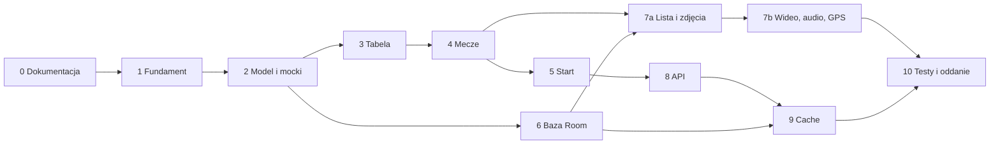

Dokumentacja opisuje etapy jako kolejne kroki; strzałki pokazują tylko, co technicznie musi istnieć wcześniej. Najważniejsze: etap 7a potrzebuje wiersza meczu i repozytorium meczów (etap 4) oraz bazy (etap 6), a etap 9 potrzebuje wyeksportowanego schematu z etapu 6.

---

## 10. Decyzje projektowe

Niespójności i luki zauważone w dokumentacji, rozstrzygnięte 13 listopada 2026:

| # | Kwestia | Decyzja | Gdzie obowiązuje |
|---|---|---|---|
| 1 | README podawało status „Etap 0”, choć praca toczy się na `feature/E1` | Status w README jest aktualizowany przy zamknięciu każdego etapu | README, każdy etap |
| 2 | README numerowało plan 0–6, PDF 0–10 (z 7a/7b) | Obowiązuje numeracja z PDF; README dostosowane | README, nazwy gałęzi |
| 3 | `StandingsUiState.Error` miał `cachedRows`, a opis Diagramu B mówił, że `Error` występuje tylko przy pustym cache | Błąd odświeżenia przy istniejących danych to jednorazowe zdarzenie obok stanu `Content`; `Error(message)` oznacza wyłącznie pusty ekran błędu | Rozdział 4.4, etapy 3–5 |
| 4 | Szablonowy motyw ma `dynamicColor = true`, co na Androidzie 12+ zastępuje paletę z Figmy | Kolory dynamiczne wyłączone; zawsze paleta z Figmy | Etap 1 |
| 5 | Dokumentacja nie określa, co wspomnienie przechowuje o meczu | Wpis zapisuje identyfikator meczu i niezmienną kopię jego danych | Etap 6 |
| 6 | `applicationId` to szablonowe `com.example.premierleagueapp` | Zostaje bez zmian; wariant mock dostaje przyrostek `.mock` | Etap 2 |

Decyzja 3 jest jedynym odstępstwem od PDF (Diagram B) – przy okazji aktualizacji dokumentacji warto poprawić tam kształt `StandingsUiState`.
